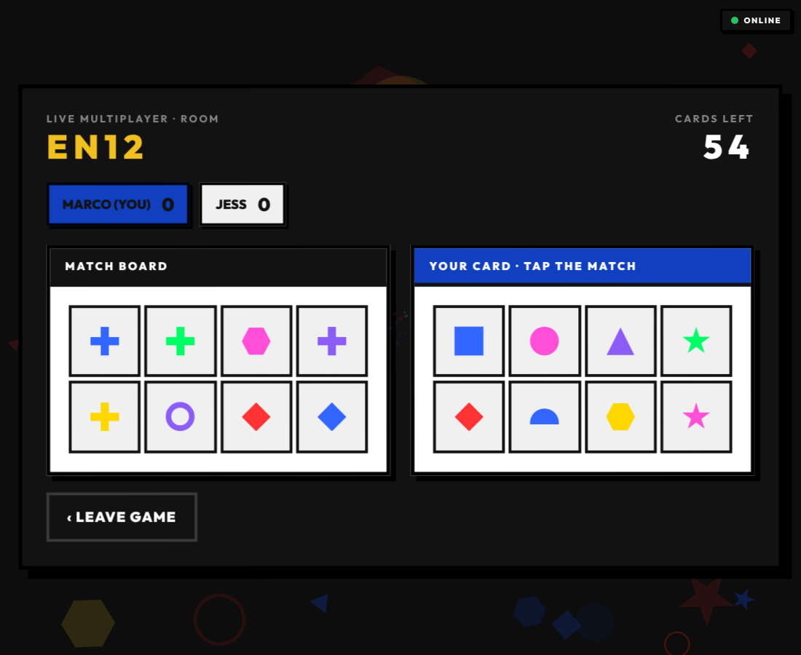

# Quickeye — Progress Log

A running record of what's built, why, and what's next. Newest phase at the top.
See [CLAUDE.md](CLAUDE.md) for the project brief and locked-in decisions.

---

## Status at a glance

| Area | State |
| --- | --- |
| Deck generation (`/shared`) | ✅ Done, tested |
| Game logic: deal/match/scoring (`/shared`) | ✅ Done, tested |
| Real-time backend (`/server` + `/infra`) | ⚠️ Phase 4 version live; Phase 5 changes committed but **not yet deployed** |
| Frontend UI (`/client`) | ✅ Multiplayer flow works end to end against the local backend |
| CI | ✅ GitHub Actions on pushes/PRs to main |

**Tests passing: 47 (4 suites). Backend: wss://gkj3douxjj.execute-api.us-east-1.amazonaws.com/prod**

---

## Phase 5: Lobby, leaderboard and multiplayer made real

Branch `claude/quickeye-lobby-live-0ix0ei`. The goal was the multiplayer lobby
working end to end on the live site. All the code is done and tested; the
deploy still has to be run from a machine with AWS credentials (see "To
deploy" below).

### What changed

**Infra (`infra/lib/quickeye-stack.ts`)**
- Least-privilege IAM: each Lambda gets only the table env vars and
  read/write grants it actually uses, instead of read/write on everything.
- All three tables are `RemovalPolicy.RETAIN` (they were `DESTROY`). Construct
  ids are unchanged, so this is a metadata change, not a replacement.
- New GSIs, both in-place adds (primary keys untouched):
  - Games `ByStatus` (status + createdAt): lobby browser and cleanup Query
    this instead of scanning the whole table.
  - Leaderboard `ByScore` (pk + score): gives the genuine top N directly.
- `cleanupGames` runs on an EventBridge schedule every 15 minutes. It is
  deliberately **not** a WebSocket route, so nobody can fire it from devtools.
- Lambdas moved from Node 20 (end of life, Lambda blocks updates) to Node 22.

**Server**
- `queryGames`: the old filter only showed games created in the last 30
  seconds. Now uses `LOBBY_LISTING_WINDOW_SECONDS` (10 min) and leans on a
  proper host-still-connected check (host's socket must still exist in the
  Connections table). Shows the real host name and skips full games.
- `cleanupGames`: only deletes lobby games that are stale (older than 10 min,
  or host gone), with a conditional delete so a game that starts mid-cleanup
  is never wiped. It used to delete every lobby game.
- Leaderboard read: was reading the newest 2N rows and sorting them, so old
  high scores dropped off. Now queries `ByScore` highest first.
- Leaderboard write: still server-side only, from authoritative game state at
  game over (the client never sends a score). Fixed a real bug: every player
  in a game got the same sort key, so they overwrote each other and only one
  score per game survived. Bots and zero scores are no longer recorded.
- Pure rules pulled into `lib/lobby.ts` and `lib/leaderboard.ts` with tests.

**Client**
- Online/offline badge on every screen (Online, Connecting, Reconnecting,
  or "Offline · solo & bots only" when the build has no `VITE_WSS_URL`). The
  multiplayer menu explains itself and disables when offline.
- New live multiplayer board drawn purely from server state, with a
  57-symbol glyph set (the old one only had 35, so it couldn't show the real
  deck). Solo play is untouched.
- New "Browse Games" lobby browser.
- Fixed: host never saw the Start button; server errors were never shown;
  leaderboard names were blank; leaving a lobby left a ghost game behind.
- WebSocket hook auto-reconnects with backoff.

**Tooling**
- `npm -w server run dev:local`: the whole backend locally (real handlers,
  in-memory DynamoDB via dynalite, fake API Gateway). No AWS needed.
- `test-client` rewritten as a proper smoke test (see below).
- `.github/workflows/ci.yml`: install, build shared, typecheck server/client/
  infra, `npm test`. Fixed the pre-existing type errors so it starts green.



### Current tables

| Table | Key | GSI | Notes |
| --- | --- | --- | --- |
| Connections | `connectionId` | none | TTL `ttl`, RETAIN |
| Games | `gameId` | `ByStatus` (status, createdAt) | TTL `ttl`, RETAIN |
| Leaderboard | `pk` (S), `sk` (N) | `ByScore` (pk, score) | RETAIN. pk = `<mode>#all-time` or `<mode>#daily#YYYY-MM-DD`; sk = millis * 1000 + offset |

### Current routes

| Trigger | Handler | Tables |
| --- | --- | --- |
| `$connect` | connect | Connections (write) |
| `$disconnect` | disconnect | Connections, Games (read/write) |
| `$default` | default | none |
| `createGame` | createGame | Games (rw), Connections (write) |
| `joinGame` | joinGame | Games (rw), Connections (write) |
| `startGame` | startGame | Games (rw), Connections (read) |
| `submitMatch` | submitMatch | Games (rw), Connections (read), Leaderboard (write) |
| `queryGames` | queryGames | Games (read), Connections (read) |
| `queryLeaderboard` | queryLeaderboard | Leaderboard (read) |
| EventBridge, every 15 min | cleanupGames | Games (rw), Connections (read) |

### Verified
- `npm test`: 47 passing. All typechecks clean. `cdk synth` clean.
- Against the local backend: `test-client --full` passes every check, and a
  two-browser-tab Playwright run did create, appear in the other tab's lobby,
  join, start, wrong pick rejected, 55 rounds to game over, both scores on the
  leaderboard. Also checked offline mode and a dropped connection.
- **Not yet verified against AWS**, because it hasn't been deployed.

### To deploy
```bash
cd infra
npx cdk diff      # read it first: no table/API should be replaced or removed
npx cdk deploy
npm -w server run test-client wss://gkj3douxjj.execute-api.us-east-1.amazonaws.com/prod
```
Leave `--full` off on the live stack unless you're happy for "Alice" and
"Bob" to land on the real leaderboard.

### Known gaps
- **Reconnection**: a dropped socket comes back with a new connectionId and
  isn't re-linked to your game. The client now tells you and drops you out
  cleanly, but you can't rejoin. Next step: a `rejoinGame` action taking
  `{ gameId, playerId }` (playerId kept in sessionStorage), which would need a
  stronger random playerId first since it would act as a secret.
- **No `leaveGame` action**: leaving works by reopening the socket so
  `$disconnect` tidies up. A non-host who leaves a lobby still counts towards
  the player total (shown as "left").
- **Full state is broadcast**, including the draw pile order, so a determined
  cheat could see upcoming cards. Strip it to a count before going public.
- **Multiplayer games all record as Marathon** (`time-attack-60`); the client
  doesn't pick a mode for multiplayer yet, and there's no round timer server-side.
- **Lobby GSI uses a single "lobby" partition**: fine at prototype scale.
- Leaderboard GSI reads are eventually consistent, so a brand new score can
  take a second to appear.

---

## Phase 4 — Deployment & Production (Live on AWS)

**✅ Backend deployed to AWS (us-east-1):**

Stack created with CDK:
- **API Gateway WebSocket API** — live, accepting connections
- **2 DynamoDB tables** — Connections (tracking sockets), Games (room state)
- **7 Lambda handlers** — compiled with esbuild, bundled, live
- **TTL auto-cleanup** — abandoned games/connections cleaned after 6 hours

**WebSocket URL:** `wss://gkj3douxjj.execute-api.us-east-1.amazonaws.com/prod`

**Test validation (local test-client):**
```
[SETUP] Alice & Bob connect ✅
[TEST] Alice creates game RBZX ✅
[TEST] Bob joins game RBZX ✅
[TEST] Alice starts game, cards dealt ✅
        - Center card: 33
        - Alice's hand: card 18
        - Both receive state broadcasts
```

**To test full game flow with your WebSocket URL:**
```bash
npm -w server run test-client "wss://your-url/prod"
```

**Client ready for deployment:**
- React SPA built: `client/dist/` (151 KB gzipped)
- All 3 screens implemented (Connect → Lobby → Game)
- Symbol rendering from deck ✅
- WebSocket message handlers wired ✅

---

## Phase 3 — React client UI (Vite + WebSocket messaging)

**Goal (v1 priority #3):** browser-based player interface for the game loop.

### What was built

**`/client` (new React SPA):**
- `hooks/useWebSocket.ts` — WebSocket connection lifecycle + message routing
- `hooks/useGame.ts` — game state (gameId, playerId, GameState)
- `screens/ConnectScreen.tsx` — WebSocket URL input (initial setup)
- `screens/LobbyScreen.tsx` — create/join room, player list, start button (host-only)
- `screens/GameScreen.tsx` — center card + player card grid, scores, placeholder symbols
- `App.tsx` — screen routing (Connect → Lobby → Game)
- Vite + TypeScript config, basic styling (gradient bg, card UI)

### Game flow (UI side)

1. User enters WebSocket URL → server URL is validated and connection opens
2. In lobby, user chooses create or join:
   - Create: generates unique room code
   - Join: enters code + connects to existing game
3. Once in game (status=playing), players see:
   - Center card (8 symbols)
   - Their hand card (8 symbols)
   - All player scores
4. Clicking a symbol sends `submitMatch` → server validates, broadcasts result

### Verification done

- UI scaffolds clean (no console errors)
- Message type safety via @quickeye/shared discriminated unions
- Screen routing logic covers all game states

### Symbol rendering & deck integration

- `src/utils/deck.ts` — generates deck once on import, exports helpers:
  - `getCardSymbols(cardId)` — returns 8 symbol IDs for a card
  - `findMatchingSymbol(centerCardId, playerCardId)` — finds the one match
  - `getSymbolEmoji(symbolId)` — maps ID to emoji
- GameScreen now renders actual symbols from the deck
- Matching symbol is highlighted with green border
- Click handler sends `submitMatch` to server

### Module format fix

- Shared now emits ES2020 modules (for Vite)
- Server/Lambda still works: esbuild in CDK transpiles ES → CommonJS

### Known gaps / next steps

- **Timer UI** — countdown bar not wired yet (GAME_CONFIG.roundCountdownSeconds)
- **Deployment** — client build ready (dist/), needs Amplify pointing to /client/dist
- **Error handling** — basic alerts, no reconnection/retry yet
- **Speed mechanic** — shrinking/rotating symbols as timer counts down (deferred)

### How to run locally

```bash
npm -w client run dev     # Vite dev server on :3000
```

Then point it at a deployed WebSocket API URL.

### Next: deploy and validate end-to-end

The entire stack is now ready:
1. Backend is built, synthesizes, and test-client verifies logic
2. Client is built and ready for deployment
3. All three packages (shared, server, client) integrate correctly

Deploy with `cdk deploy` and test the full game flow.

---

## Phase 2 — Real-time multiplayer plumbing (WebSocket + Lambda + DynamoDB)

**Goal (v1 priority #2):** get real-time game-state sync working over serverless
infrastructure with placeholder UI to come later.

### What the architecture is (plain English)
- **API Gateway WebSocket API** — a persistent two-way "phone line" so the server
  can *push* game updates to every player instantly (normal HTTP can't do that).
  It routes each incoming message to a Lambda based on the message's `action` field.
- **Lambda functions** — one small function per action; they run only when a
  message arrives (pay-per-use, fits AWS credits).
- **DynamoDB** — two tables holding all state, with TTL auto-cleanup of abandoned
  games:
  - `ConnectionsTable`: `connectionId → { gameId, playerId }` (who is this socket?)
  - `GamesTable`: `gameId (room code) → full GameState` (the authoritative truth).

### What was built

**`/shared` (new game modules — used by server now, client later):**
- `gameTypes.ts` — `GameState`, `Player`, `GameStatus`, and `GAME_CONFIG`
  (tunable params: min/max players 2–6, deck size, TTL, speed-round timing).
- `messages.ts` — the WebSocket message protocol as TypeScript discriminated
  unions (`ClientMessage` browser→server, `ServerMessage` server→browser).
- `gameLogic.ts` — pure functions (no network/db) so server and future client
  practice mode share identical rules:
  - `shuffledCardIds` (Fisher–Yates, injectable RNG for deterministic tests)
  - `dealInitial` (center card + one card per player)
  - `applyMatch` (authoritative match validation + next-state computation)
  - `generateRoomCode` (4-char, ambiguity-free alphabet)
- `gameLogic.test.ts` — 10 tests covering shuffle, deal, correct/incorrect
  matches, unknown players, and game-over on empty pile.

**`/server` (Lambda handlers):**
- `lib/dynamo.ts` — DynamoDB Document-client access layer. Includes
  `putGameIfCenterUnchanged` — **optimistic locking** so two simultaneous correct
  matches can't both advance the game (the loser is told "too slow").
- `lib/apigw.ts` — pushes messages back to clients via the API Gateway Management
  API; `broadcast` fans out to all players, silently dropping dead sockets.
- `lib/util.ts` — response helpers, TTL calculation, random ids.
- `handlers/`:
  - `connect.ts` — records the new socket (identity filled in later).
  - `disconnect.ts` — marks player disconnected, notifies others, cleans up.
  - `createGame.ts` — host creates a room, gets a unique code.
  - `joinGame.ts` — join by code (validates exists / not started / not full).
  - `startGame.ts` — host-only; deals opening layout, broadcasts playing state.
  - `submitMatch.ts` — **authoritative anti-cheat path**: server re-checks the
    match; client's claim is only a hint. Uses optimistic locking on write.
  - `default.ts` — friendly error for unrecognized actions.

**`/infra` (AWS CDK stack):**
- `lib/quickeye-stack.ts` — provisions the 2 DynamoDB tables (on-demand billing,
  TTL enabled), 7 Lambda functions (bundled from TypeScript via esbuild, which
  also pulls in `@quickeye/shared`), and the WebSocket API with all routes wired.
  IAM: each handler gets table read/write; broadcasting handlers get
  `ManageConnections`. Outputs the `wss://` URL for the client.
- `bin/quickeye.ts`, `cdk.json`, `tsconfig.json` — CDK app scaffolding.
- **Verified with `cdk synth`** (dry run) — stack is valid and all Lambdas bundle.

### Game flow (how it fits together)
1. Client opens socket → `$connect` stores the connection.
2. Client sends `createGame` → server makes a room, replies `joined` (with the
   player's `playerId` + initial state).
3. Others send `joinGame` with the code → added to lobby; everyone gets a
   `stateUpdate` broadcast.
4. Host sends `startGame` → `dealInitial` deals cards; `stateUpdate` broadcast.
5. Player sends `submitMatch` with a `symbolId` → server validates via
   `applyMatch`; on success the player's card becomes the new center, they draw
   & score, and everyone gets a `stateUpdate`. Empty draw pile → game finishes.

### Verification done
- `npm test` → 25/25 passing (deck + game logic).
- `npx tsc -p server/tsconfig.json --noEmit` → server typechecks clean.
- `cd infra && npx cdk synth` → stack synthesizes, all 7 Lambdas bundle.

### Known gaps / deferred (prototype-first)
- **Not deployed to AWS yet** — synthesis verified, but `cdk deploy` (and a
  one-time `cdk bootstrap`) still needs to run against the real account.
- **Reconnection handling** — a dropped player is marked disconnected but not
  re-linkable yet (flagged in CLAUDE.md as a post-core-loop item).
- **Speed-variant mechanic** (countdown, shrink/rotate) — config values exist in
  `GAME_CONFIG` but no round timer logic yet.
- **IAM least-privilege** — handlers currently get RW on both tables for
  simplicity; scope down in a later hardening pass.

### How to deploy and test
```bash
# one-time per account/region:
cd infra && npx cdk bootstrap
# deploy (prints the wss:// WebSocket URL on completion):
npx cdk deploy

# Copy the wss:// URL from the output, then test:
npm install -w server
npm -w server run test-client wss://your-api-gateway-url/prod
```

The test client simulates a full game (create → join → start → match), so you
can verify the backend is live and responding before building the UI.

---

## Phase 1 — Deck generation algorithm (`/shared`)

**Goal (v1 priority #1):** the mathematical core — every pair of cards shares
exactly one symbol — unit-tested in isolation.

- Implemented as a **Steiner system S(2, 8, 57)** via a projective plane PG(2, 7):
  57 cards, 8 symbols each, 57-symbol pool, guaranteed one-and-only-one match
  between any two cards.
- `deckGeneration.ts` (`generateDeck`, `findMatch`, `isValidMatch`) +
  `deckGeneration.test.ts` (15 tests) verifying deck size, the core invariant
  across all 1,596 card pairs, symbol distribution, and API behavior.
- See [shared/README.md](shared/README.md) for the full algorithm write-up.

---

## Repo shape (per CLAUDE.md)

```
/client   React SPA (Amplify Hosting)            — not started
/server   Lambda handlers (WebSocket routes)     — built
/shared   deck-gen + game logic + message types  — built, tested
/infra    AWS CDK stack                          — built, synthesizes
```
